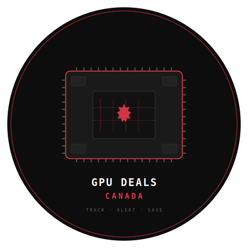
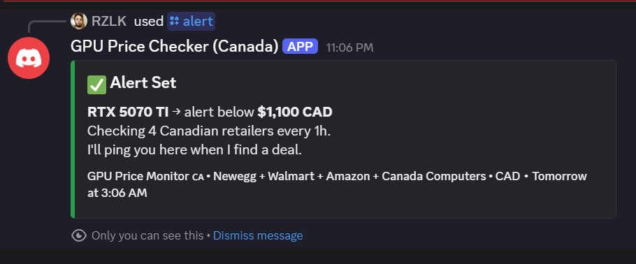
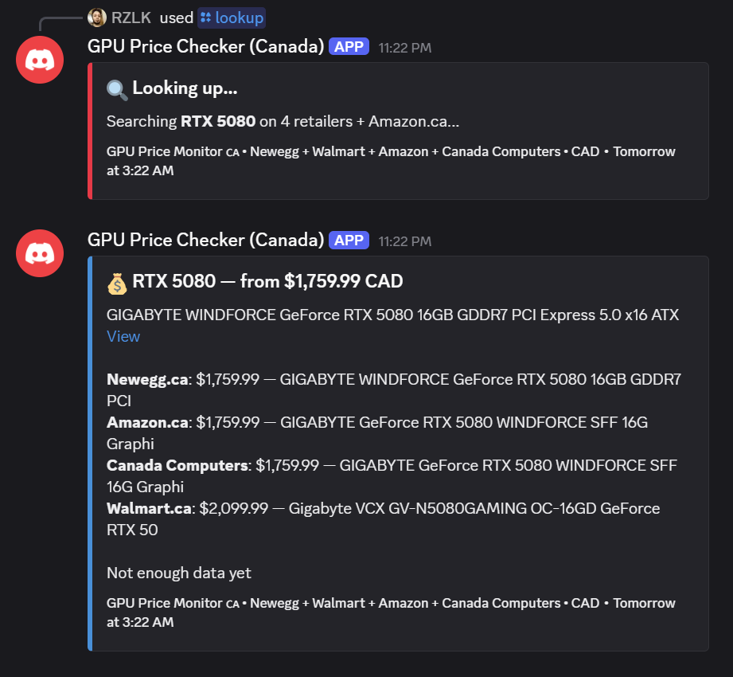
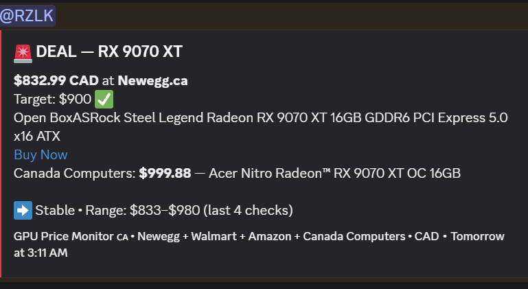

<p align="center">
  
</p>

<h1 align="center">🇨🇦 GPU Deals Canada</h1>

<p align="center">
  <strong>Free GPU price alerts across 4 Canadian retailers. Because MSRP is a lie.</strong>
</p>

<p align="center">
  <a href="#-quickstart"></a>
  <a href="https://opensource.org/licenses/MIT"></a>
  <a href="https://www.python.org/"></a>
  <a href="https://discord.com"></a>
  
</p>

<p align="center">
  <a href="#-the-problem">The Problem</a> •
  <a href="#-how-it-works">How It Works</a> •
  <a href="#-screenshots">Screenshots</a> •
  <a href="#-commands">Commands</a> •
  <a href="#-quickstart">Quickstart</a> •
  <a href="#-deploy">Deploy</a>
</p>

---

> **Just want alerts without running your own bot?** Join our Discord server: [GPU Deals Canada](https://discord.gg/7Kufdzgd)

---

## 💀 The Problem

The Canadian GPU market is broken.

| GPU | MSRP (CAD) | Actual Street Price (CAD) | Markup |
|-----|-----------|--------------------------|--------|
| RTX 5090 | $2,729 | $5,299+ | **94%** |
| RTX 5080 | $1,364 | $1,759+ | **29%** |
| RTX 5070 Ti | $1,022 | $1,369+ | **34%** |

GDDR7 memory shortage + AI demand = prices that make your wallet cry. Founders Edition cards sell out in minutes. If you're not watching prices 24/7, you're not getting a deal.

**This bot watches for you.**

## ⚡ How It Works

```
┌──────────────────────────────────────────────────────┐
│  You: /alert RTX 5080 1500                           │
│                                                      │
│  Bot checks 4 Canadian retailers every hour:         │
│  ├── Newegg.ca                                       │
│  ├── Amazon.ca                                       │
│  ├── Canada Computers                                │
│  └── Walmart.ca                                      │
│                                                      │
│  Price drops below $1,500?                           │
│  → 🚨 @you DEAL ALERT — RTX 5080 — $1,459 CAD      │
│  → Best price across all 4 retailers                 │
│  → Direct buy link included                          │
│  → Price trend data attached                         │
└──────────────────────────────────────────────────────┘
```

**No API keys. No paid tiers. No LLM costs.** Direct retailer data from 4 Canadian stores — the same sites you'd check manually, automated.

## 📸 Screenshots

### Set a price alert (private — only you see this)
<p align="center">
  
</p>

### Price comparison across 4 retailers
<p align="center">
  
</p>

### 🚨 Deal alert — price dropped below target
<p align="center">
  
</p>

## 🎮 Commands

| Command | What It Does |
|---------|-------------|
| `/alert RTX 5080 1500` | Get pinged when the RTX 5080 drops below $1,500 CAD |
| `/lookup RTX 5070 TI` | Instant price check across all 4 retailers — no alert needed |
| `/prices` | Market scan — current lowest prices for 8 popular GPUs |
| `/check` | Force an immediate price check on all your active alerts |
| `/trend RTX 5090` | Price history — current, all-time low/high, direction |
| `/list` | View your active alerts (private) |
| `/remove RTX 5080` | Remove an alert |

All commands support **autocomplete** — start typing a GPU name and the bot suggests matches.

## 🏗️ Architecture

```
                         ┌──────────────────────┐
┌──────────────┐         │    Discord Bot        │
│ Discord User │────────▶│    (discord.py)       │
│ /alert       │         │                       │
│ /check       │         │  ┌────────────────┐   │       ┌──────────────┐
│ /lookup      │         │  │  Alert Engine   │───│──────▶│  Newegg.ca   │
└──────────────┘         │  │  • JSON store   │   │  │    │  (requests)  │
                         │  │  • 1hr cron     │   │  │    └──────────────┘
                         │  │  • Deduped      │   │  │    ┌──────────────┐
                         │  │    GPU checks   │───│──┼───▶│  Walmart.ca  │
                         │  └────────────────┘   │  │    │  (curl_cffi)  │
                         │                       │  │    └──────────────┘
                         │  ┌────────────────┐   │  │    ┌──────────────┐
                         │  │ Price History   │   │  ├───▶│  Amazon.ca   │
                         │  │ • Trend data    │   │  │    │  (curl_cffi)  │
                         │  │ • 500 entries   │   │  │    └──────────────┘
                         │  │   per GPU       │   │  │    ┌──────────────┐
                         │  └────────────────┘   │  └───▶│  Canada      │
                         │                       │       │  Computers   │
                         └──────────────────────┘       │  (curl_cffi)  │
                                                        └──────────────┘
```

| Component | Technology | Why |
|-----------|-----------|-----|
| Bot Framework | discord.py | Mature, async, slash command support |
| Newegg.ca | requests + BeautifulSoup | Server-rendered HTML, no anti-bot |
| Walmart.ca | curl_cffi + `__NEXT_DATA__` JSON | Next.js site — JSON is embedded in page, 100% reliable |
| Amazon.ca | curl_cffi + HTML parsing | Needs TLS fingerprint spoofing to bypass bot detection |
| Canada Computers | curl_cffi + hidden AJAX endpoint | Found their internal API — returns structured JSON |
| Storage | JSON files | Zero dependencies, trivially portable |
| Scheduling | asyncio background task | No external cron needed |

### Why These 4 Retailers?

We tested every major Canadian GPU retailer. These are the ones that work reliably without paid proxies or headless browsers:

| Retailer | Method | Status |
|----------|--------|--------|
| Newegg.ca | Plain HTTP | ✅ Works |
| Walmart.ca | TLS fingerprint spoofing | ✅ Works |
| Amazon.ca | TLS fingerprint spoofing | ✅ Works |
| Canada Computers | Hidden AJAX API | ✅ Works |
| Best Buy Canada | Cloudflare | ❌ Blocked |
| Memory Express | Cloudflare | ❌ Blocked |

## 🚀 Quickstart

### 1. Create a Discord Bot (2 minutes)

Go to [Discord Developer Portal](https://discord.com/developers/applications) → New Application → Bot → **enable MESSAGE CONTENT intent** → copy the bot token.

### 2. Clone & Install

```bash
git clone https://github.com/RZ-Logic/gpu-price-alert-bot.git
cd gpu-price-alert-bot
pip install discord.py requests beautifulsoup4 curl_cffi
```

### 3. Run

**Windows:**
```bash
set DISCORD_BOT_TOKEN=your-bot-token
python gpu_discord_bot.py
```

**Mac/Linux:**
```bash
export DISCORD_BOT_TOKEN=your-bot-token
python gpu_discord_bot.py
```

The bot prints an invite link on startup. Click it to add to your server. Done.

## 🌐 Deploy (Keep It Running 24/7)

### Railway (recommended — free tier available)

```bash
npm install -g @railway/cli
railway login
railway init
railway up
```

Set `DISCORD_BOT_TOKEN` as an environment variable in the Railway dashboard.

### Docker

```dockerfile
FROM python:3.12-slim
WORKDIR /app
COPY gpu_discord_bot.py .
RUN pip install discord.py requests beautifulsoup4 curl_cffi
CMD ["python", "gpu_discord_bot.py"]
```

```bash
docker build -t gpu-bot .
docker run -d -e DISCORD_BOT_TOKEN=your-token --name gpu-bot gpu-bot
```

### Any VPS ($4-6/month)

```bash
git clone https://github.com/RZ-Logic/gpu-price-alert-bot.git
cd gpu-price-alert-bot
pip install discord.py requests beautifulsoup4 curl_cffi
screen -S gpu-bot
export DISCORD_BOT_TOKEN=your-token
python gpu_discord_bot.py
# Ctrl+A, D to detach
```

## 💰 Cost

| Item | Cost |
|------|------|
| Discord bot | Free |
| Retailer scraping | Free |
| Railway/local hosting | Free |
| **Total** | **$0/month** |

Compare this to HotStock Premium ($5-11/month USD), which doesn't even cover Canadian retailers properly.

## 🗺️ Roadmap

- [ ] Price history charts — visual graphs in Discord embeds
- [ ] Best Buy + Memory Express — via headless browser when Cloudflare is bypassed
- [ ] Used market tracking — eBay.ca, Facebook Marketplace
- [ ] Multi-currency — USD/CAD comparison for cross-border deals
- [ ] Browser extension — price alerts directly on retailer websites
- [ ] Webhook mode — Telegram/email alerts alongside Discord

## 🤝 Contributing

The codebase is a single Python file. Read it in 10 minutes, contribute in 20.

```bash
git clone https://github.com/RZ-Logic/gpu-price-alert-bot.git
cd gpu-price-alert-bot
python gpu_discord_bot.py  # Test locally
# Submit PR
```

**Great first contributions:**
- Support for more retailers (direct scraping or new hidden APIs)
- French-language support for Quebec gamers
- Price comparison visualization
- Webhook integrations (Telegram, Slack, email)

## 📜 License

MIT — do whatever you want with it.

---

<p align="center">
  Built by a gamer who does <a href="https://www.youtube.com/@BT_01">no-damage boss fights when time permits</a> and builds <a href="https://github.com/RZ-Logic/jobsignal">open-source tools that help people</a>.
  <br><br>
  <strong>If this saved you money on a GPU, star the repo ⭐</strong>
</p>
