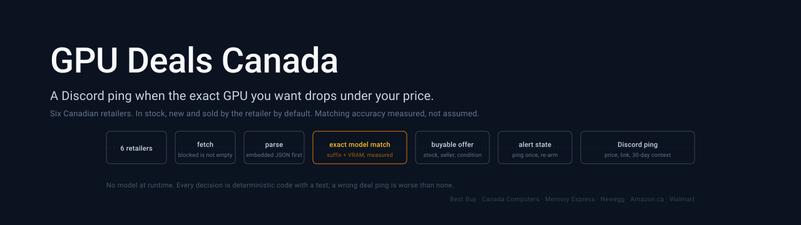

# Architecture

<p align="center">
  
</p>

How GPU Deals Canada is built: where a model is and is not involved, what each component does, the stack, and the properties the code aims for. For the decisions behind it, see [build-decisions.md](build-decisions.md). Back to the [README](../README.md).

## Where is the AI?

Adapted from the *"Where is the AI?"* table in [FinAgent OS](https://github.com/RZ-Logic/finagent-os). At runtime there is none: every stage is deterministic code with tests. Models were used to build and to measure the bot (marked below), never to decide whether a listing is a deal.

| # | Stage | Deterministic? | What it does |
|---|---|:-:|---|
| 1 | **Fetch** | ✅ | `retailers/http.py`: pinned `curl_cffi` TLS fingerprints, per-host spacing, retries on blocks and transient 5xx, and block detection (status codes, bot-check page markers, block redirects). A block is reported as `BLOCKED`, never as an empty result. |
| 2 | **Parse** | ✅ | One adapter per retailer, each with a pure `parse()` tested offline against saved pages. Embedded JSON first (Newegg's page state, Walmart's `__NEXT_DATA__`, Best Buy's and Canada Computers' JSON endpoints), HTML only for Memory Express and Amazon.ca. |
| 3 | **Category gate** | ✅ | Each adapter drops rows the retailer's own data says are not graphics cards, and fills stock, seller, condition, regular price and shipping. |
| 4 | **Model match** | ✅ | `matching.py`: titles are tokenised, model mentions parsed into family, number, suffix and VRAM, vendor part codes decoded, and laptops, prebuilts, accessories and bundles rejected. Precision first: an ambiguous title is a non-match. |
| 5 | **Eligibility** | ✅ | `pricing.py`: the model's price floor, condition, stock and seller policy, then the cheapest offer. |
| 6 | **Alert decision** | ✅ | `alerts.py`: a pure state machine (ping once, further drops only, re-arm after two scans above target in which the retailer that had the deal answered). |
| 7 | **Store and deliver** | ✅ | `store.py` (SQLite) and `bot.py` (discord.py): history, health, delivery with a DM fallback. |
| *build* | Code, review and labels | ❌ agents | Claude agents wrote modules against fixed interfaces, reviewed them in separate slices, and produced blind labels for the evaluation. Every agent claim was checked by running code or reading the cited lines before it was acted on. |

> **The principle:** a wrong deal ping costs more than a missed one: it sends you to buy the wrong card, or to a sold-out page. So the decision path is code that can be tested, and the matcher's precision is measured on listings it never saw before any number goes in the README.

## What ships

```
┌──────────────────────────────────────────────────────────────────────────────┐
│                                                                              │
│   /alert gpu:"RTX 5070 Ti" target:1500                                       │
│                                                                              │
│     every CHECK_INTERVAL_MINUTES (default 60)                                │
│       │                                                                      │
│       ▼                                                                      │
│     pricing.scan_models: one search per distinct query, six retailers        │
│       ├─ bestbuy         JSON search API + stock API                         │
│       ├─ canadacomputers JSON search, graphics-card category, cheapest first │
│       ├─ memoryexpress   video-card category page                            │
│       ├─ newegg          embedded page state, In Stock filter                │
│       ├─ amazon          Graphics Cards category, buy-box merchant           │
│       └─ walmart         __NEXT_DATA__ (marketplace sellers)                 │
│       │   a retailer that blocks is skipped for the rest of the run          │
│       ▼                                                                      │
│     matching.match(title, model)  -> exact model, suffix, VRAM               │
│     pricing.offers(...)           -> floor, new, not sold out, first party   │
│       ▼                                                                      │
│     alerts.decide(state, best price, best retailer, retailers that answered) │
│       ▼                                                                      │
│     Discord: ping once with price, link, 30-day low and median, next best    │
│     SQLite: matched offers above the floor, every request actually made      │
│                                                                              │
└──────────────────────────────────────────────────────────────────────────────┘
```

### Component overview

| Component | What it is | Role of a model |
|---|---|---|
| `gpu_alerts/retailers/` | Six adapters, the shared fetch layer and the `Listing` / `ScrapeResult` / `Status` types | None |
| `gpu_alerts/matching.py` | Title parser and matcher | None |
| `gpu_alerts/catalog.py`, `data/catalog.json` | 33 GPU models with suffix, VRAM, search query and price floor | None |
| `gpu_alerts/pricing.py` | Concurrent scans, eligibility policy, run-level block breaker | None |
| `gpu_alerts/alerts.py` | Alert state machine | None |
| `gpu_alerts/store.py` | SQLite: alerts, scans, matched offers, retailer outcomes | None |
| `gpu_alerts/bot.py` | Slash commands, background loop, delivery, owner health DM | None |
| `gpu_alerts/__main__.py` | CLI: `run`, `lookup`, `health`, `import-v1` | None |
| `eval/` | Pre-registration, data splits, v1 baseline, scorer, results | Labels from blind labeler agents, checked against an automated labeler |
| `tests/` | 391 offline tests on saved retailer pages and fakes, 6 live smoke tests | None |

## Stack

| Layer | Tool | Why |
|---|---|---|
| Bot | [discord.py](https://github.com/Rapptz/discord.py) 2.7 | Slash commands, `tasks.loop`, deferred replies |
| HTTP | [curl_cffi](https://github.com/lexiforest/curl_cffi) 0.16 | Browser TLS fingerprints; plain `requests` gets 403 from Newegg.ca |
| HTML | [Beautiful Soup](https://www.crummy.com/software/BeautifulSoup/) 4 | Amazon.ca and Memory Express card markup |
| Storage | SQLite (standard library), WAL mode | One file, no server, safe across threads with one lock |
| Tests | pytest | Offline by default; live tests opt in with `-m live` |

**No infrastructure novelty.** No queue, no browser, no proxy, no paid API. The bot is one process that makes ordinary HTTPS requests, so it runs on a desktop or a small server.

## Engineering properties

| Principle | How it works |
|---|---|
| A block is not an empty result | `Status` separates `OK`, `EMPTY`, `BLOCKED`, `PARSE_ERROR`, `NETWORK_ERROR` and `DISABLED`; a failed scan never moves an alert. |
| Polite by construction | At least 2 s between requests to one host (10 s for Amazon.ca), and a retailer that blocks is skipped for the rest of the run. |
| Precision first | The matcher rejects ambiguous titles; an unknown VRAM fails a VRAM-specific model. |
| One ping per deal | The notified price and retailer are stored; a further ping needs a 3% or $25 drop, and re-arming needs two scans above target in which that retailer answered. |
| Concurrent edits are safe | Each write is one SQLite transaction; background writes check the alert's revision, so a `/alert` made during a scan is never overwritten. |
| Pinned dependencies | `curl_cffi`'s impersonation targets change between versions, so `requirements.txt` pins exact versions. |
| Measured claims | Matching accuracy comes from a pre-registered, held-out evaluation; the caveats are in the README next to the numbers. |
